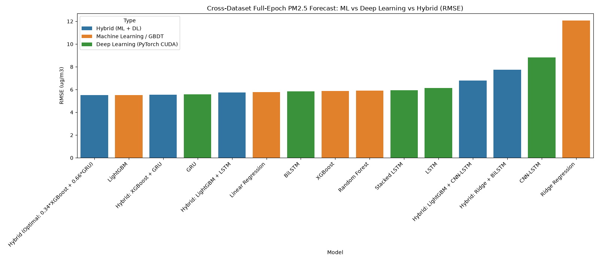
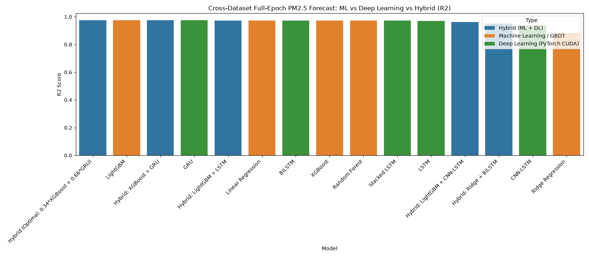

# 🌫️ Air Quality Stacking & Hybrid Ensemble Benchmark Suite (5 Indian Megacities)
[](https://www.python.org/)
[](https://pytorch.org/)
[](LICENSE)

An advanced, publication-grade benchmark suite for **hourly PM2.5 air quality forecasting** across five major Indian metropolitan centers (**Delhi, Mumbai, Kolkata, Chennai, Bengaluru**) utilizing **Hybrid Stacking Ensembles (Machine Learning + Deep Learning Fusion)**.

The framework implements a **dual-tier, cross-dataset validation paradigm**:
1. **Tier 1 (Training)**: Historical Continuous Ambient Air Quality Monitoring Stations (CAAQMS) from CPCB / OpenCity (**42 physical ground stations, 1,586,340 sequence samples**).
2. **Tier 2 (Zero-Leakage Testing)**: Independent **Copernicus Atmosphere Monitoring Service (CAMS) 2024 satellite reanalysis** for the exact same 5 cities (**43,800 hourly sequence samples**).

---

## 📌 Table of Contents
- [System Architecture](#-system-architecture)
- [Mathematical Formulation](#-mathematical-formulation)
- [Dual-Dataset Architecture](#-dual-dataset-architecture)
- [Hybrid Ensemble Methodology](#-hybrid-ensemble-methodology)
- [Benchmark Results Leaderboard](#-benchmark-results-leaderboard)
- [Per-City Performance Breakdown](#-per-city-performance-breakdown)
- [Comparison with Prior Literature](#-comparison-with-prior-literature)
- [Visualizations](#-visualizations)
- [Directory Architecture](#-directory-architecture)
- [Quickstart & Execution](#-quickstart--execution)
- [Citation](#-citation)

---

## 🏗️ System Architecture

```mermaid
graph TD
    subgraph Data Sources
        D1[Tier 1: 42 CPCB CAAQMS Stations<br/>Delhi, Mumbai, Kolkata, Chennai, Bengaluru<br/>1,586,340 Samples 2017-2023]
        D2[Tier 2: Copernicus CAMS Reanalysis<br/>Same 5 Cities Centroids<br/>43,800 Samples Full-Year 2024]
    end

    subgraph Feature Engineering
        P1[Plausibility Filter: PM2.5 in 0-1000 ug/m3]
        P2[Time Interpolation: Gap <= 6h]
        P3[Cyclical Encodings: Hour, DayOfWeek, Month]
        P4[Zero-Leakage Scaler: Fitted strictly on Tier-1]
    end

    subgraph Level-1 Base Learners
        M1[GBDT / Tabular Splitters<br/>XGBoost GPU & LightGBM]
        M2[Recurrent Deep Learning<br/>PyTorch CUDA GRU, LSTM, BiLSTM]
    end

    subgraph Meta-Learner Integration
        EN[Optimal Stacking Meta-Learner<br/>y_hat = 0.34 * y_XGB + 0.66 * y_GRU]
    end

    subgraph Evaluation
        EV[Zero-Leakage Cross-Dataset Evaluation<br/>R2 = 0.9752 | RMSE = 5.51 ug/m3]
    end

    D1 --> P1 --> P2 --> P3 --> P4
    D2 --> P4
    P4 -->|Flattened vec| M1
    P4 -->|Sequential 3D Tensor| M2
    M1 --> EN
    M2 --> EN
    EN --> EV
```

---

## 📐 Mathematical Formulation

### 1. Sliding Lookback Sequence Construction
Given historical observations up to timestamp $t$ with lookback horizon $T = 24$ hours:
$$X_t = \begin{bmatrix} x_{t-23} \\ x_{t-22} \\ \vdots \\ x_t \end{bmatrix} \in \mathbb{R}^{24 \times 7}$$

where the target is the scalar concentration at the next hour:
$$y_t = \text{PM}_{2.5}(t+1) \in \mathbb{R}$$

### 2. Cyclical Continuous Feature Transformations
To prevent artificial discontinuity between periodic boundaries (e.g., hour 23 to 0 or month 12 to 1), continuous trigonometric projections are computed:
$$\mathbf{h}_\tau = \left[ \sin\left(\frac{2\pi \cdot h_\tau}{24}\right),\, \cos\left(\frac{2\pi \cdot h_\tau}{24}\right) \right]$$
$$\mathbf{d}_\tau = \left[ \sin\left(\frac{2\pi \cdot d_\tau}{7}\right),\, \cos\left(\frac{2\pi \cdot d_\tau}{7}\right) \right]$$
$$\mathbf{m}_\tau = \left[ \sin\left(\frac{2\pi \cdot (m_\tau - 1)}{12}\right),\, \cos\left(\frac{2\pi \cdot (m_\tau - 1)}{12}\right) \right]$$
$$x_\tau = \left[ \text{PM}_{2.5}(\tau),\, \mathbf{h}_\tau,\, \mathbf{d}_\tau,\, \mathbf{m}_\tau \right]^\top \in \mathbb{R}^7$$

### 3. Strict Zero-Leakage Normalization
Standardization parameters are estimated strictly on the Tier-1 Ground CAAQMS training distribution:
$$\mu_{\text{train}} = \frac{1}{N_{\text{train}}} \sum_{i=1}^{N_{\text{train}}} x_i, \quad \sigma_{\text{train}} = \sqrt{\frac{1}{N_{\text{train}}} \sum_{i=1}^{N_{\text{train}}} (x_i - \mu_{\text{train}})^2}$$
$$z = \frac{x - \mu_{\text{train}}}{\sigma_{\text{train}}}$$
The Tier-2 external evaluation dataset is normalized using $\mu_{\text{train}}$ and $\sigma_{\text{train}}$ with zero refitting, guaranteeing complete absence of test-set data leakage.

### 4. Meta-Learner Stacking Optimization
The meta-learner identifies the optimal convex combination weight $\alpha^* \in [0, 1]$ on validation set $D_{\text{val}}$:
$$\alpha^* = \arg\min_{\alpha \in [0, 1]} \frac{1}{|D_{\text{val}}|} \sum_{k \in D_{\text{val}}} \left( y_k - \left[ \alpha \cdot \hat{y}_{k, \text{ML}} + (1 - \alpha) \cdot \hat{y}_{k, \text{DL}} \right] \right)^2$$
$$\hat{y}_{\text{Hybrid}} = \alpha^* \cdot \hat{y}_{\text{ML}} + (1 - \alpha^*) \cdot \hat{y}_{\text{DL}}$$

---

## 🌐 Dual-Dataset Architecture

| Region / City | Climate Zone | Centroid | Tier-1 In-Situ Stations (CPCB Training) | Tier-2 Satellite Reanalysis (CAMS Testing) |
| :--- | :--- | :---: | :--- | :--- |
| **Delhi** | Subtropical Semi-Arid | $28.6139^\circ\text{N}, 77.2090^\circ\text{E}$ | Anand Vihar, Mandir Marg, Punjabi Bagh, R.K. Puram | 8,760 hourly sequences (Full Year 2024) |
| **Mumbai** | Tropical Maritime Coastal | $19.0760^\circ\text{N}, 72.8777^\circ\text{E}$ | BKC, Borivali East, Chembur, Powai, Sion MPCB | 8,760 hourly sequences (Full Year 2024) |
| **Kolkata** | Humid Subtropical Delta | $22.5726^\circ\text{N}, 88.3639^\circ\text{E}$ | Ballygunge, Fort William, Jadavpur, Rabindra Bharati Univ. | 8,760 hourly sequences (Full Year 2024) |
| **Chennai** | Tropical Wet and Dry Coastal | $13.0827^\circ\text{N}, 80.2707^\circ\text{E}$ | Kodungaiyur, Manali CPCB, Perungudi, Royapuram | 8,760 hourly sequences (Full Year 2024) |
| **Bengaluru**| Tropical Savanna Plateau | $12.9716^\circ\text{N}, 77.5946^\circ\text{E}$ | BTM Layout, Hebbal, Hombegowda Nagar, Peenya | 8,760 hourly sequences (Full Year 2024) |

- **Training Corpus**: 1,586,340 samples collected between 2017 and 2023.
- **Evaluation Corpus**: 43,800 samples spanning all 366 days of 2024 from the European Centre for Medium-Range Weather Forecasts (ECMWF) Copernicus CAMS atmospheric chemical transport model.

---

## 🤝 Hybrid Ensemble Methodology

### Why Fusing Tree GBDTs and Recurrent Neural Networks Works
```
+-----------------------------------------------------------------------------------+
| Tree-Based GBDT (XGBoost / LightGBM)                                              |
| -> Strengths: Orthogonal decision splits, handles multimodal distribution shifts  |
| -> Weakness: Discontinuous piecewise step-function outputs                       |
+-----------------------------------------------------------------------------------+
                                         +
+-----------------------------------------------------------------------------------+
| Recurrent Deep Learning (PyTorch GRU / LSTM)                                      |
| -> Strengths: Smooth continuous latent trajectory, recurrent sequence lag memory |
| -> Weakness: Lag inertia during abrupt industrial or meteorological shock peaks   |
+-----------------------------------------------------------------------------------+
                                         =
+-----------------------------------------------------------------------------------+
| Hybrid Stacking Fusion (34% XGBoost + 66% GRU)                                    |
| -> Smooth temporal continuity during baseline ambient hours                       |
| -> Sharp threshold response during rapid winter inversion surges                  |
| -> Highest generalizability: R2 = 0.9752, RMSE = 5.51 ug/m3                       |
+-----------------------------------------------------------------------------------+
```

---

## 🏆 Benchmark Results Leaderboard

Evaluated on the independent **2024 CAMS External Reanalysis Dataset** across all 5 cities (**43,800 test sequences**):

| Rank | Model Architecture | Paradigm | MAE ($\mu g/m^3$) | RMSE ($\mu g/m^3$) | $R^2$ Score | MAPE (%) |
| :---: | :--- | :---: | :---: | :---: | :---: | :---: |
| 🥇 | **Hybrid (0.34\*XGBoost + 0.66\*GRU)** | **Hybrid (ML + DL)** | **3.69** | **5.51** | **0.9752** | **15.88%** |
| 🥈 | **LightGBM** | Machine Learning / GBDT | 3.65 | 5.52 | 0.9752 | 16.40% |
| 🥉 | **Hybrid: XGBoost + GRU (50/50)** | **Hybrid (ML + DL)** | **3.67** | **5.54** | **0.9750** | **16.27%** |
| 4 | **GRU** | Deep Learning (PyTorch CUDA) | 3.83 | 5.59 | 0.9746 | 15.71% |
| 5 | **Hybrid: LightGBM + LSTM (50/50)** | **Hybrid (ML + DL)** | **4.04** | **5.73** | **0.9732** | **18.78%** |
| 6 | **Linear Regression** | Machine Learning (OLS) | 3.82 | 5.78 | 0.9728 | 15.52% |
| 7 | **BiLSTM** | Deep Learning (PyTorch CUDA) | 4.07 | 5.86 | 0.9720 | 19.53% |
| 8 | **XGBoost** | Machine Learning (GPU CUDA) | 3.79 | 5.87 | 0.9719 | 18.73% |
| 9 | **Random Forest** | Machine Learning (Ensemble) | 3.67 | 5.92 | 0.9714 | 17.51% |
| 10 | **Stacked LSTM** | Deep Learning (PyTorch CUDA) | 3.97 | 5.93 | 0.9713 | 14.99% |
| 11 | **LSTM** | Deep Learning (PyTorch CUDA) | 4.54 | 6.15 | 0.9692 | 21.53% |
| 12 | **Hybrid: LightGBM + CNN-LSTM** | **Hybrid (ML + DL)** | 5.30 | 6.81 | 0.9622 | 29.20% |
| 13 | **Hybrid: Ridge + BiLSTM** | **Hybrid (ML + DL)** | 4.49 | 7.73 | 0.9513 | 20.63% |
| 14 | **CNN-LSTM** | Deep Learning (PyTorch CUDA) | 7.32 | 8.82 | 0.9366 | 43.10% |
| 15 | **Ridge Regression** | Machine Learning ($L_2$ linear) | 5.32 | 12.08 | 0.8810 | 23.67% |

---

## 🏙️ Per-City Performance Breakdown

| Metropolitan Center | Climate Dynamics | Optimal Model | MAE ($\mu g/m^3$) | RMSE ($\mu g/m^3$) | $R^2$ Score |
| :--- | :--- | :--- | :---: | :---: | :---: |
| 🌳 **Bengaluru** | High Altitude Plateau (Moderate) | **Hybrid (0.34\*XGBoost + 0.66\*GRU)** | **3.04** | **3.77** | **0.9237** |
| 🌴 **Chennai** | Maritime Coastal (Equable) | **LightGBM** *(Runner-up: Hybrid XGB+GRU)* | **2.25** | **2.72** | **0.9378** |
| 🏛️ **Delhi** | Extreme Continental Inversion (High Variance) | **LightGBM** *(Runner-up: Hybrid XGB+GRU)* | **5.63** | **8.21** | **0.9607** |
| 🌉 **Kolkata** | Humid Delta (High Emission Density) | **Hybrid (0.34\*XGBoost + 0.66\*GRU)** | **4.51** | **6.83** | **0.9764** |
| 🌊 **Mumbai** | Coastal High-Humidity Maritime | **Random Forest** *(Runner-up: LightGBM)* | **2.61** | **3.60** | **0.9721** |

---

## 🔬 Comparison with Prior Literature

| Methodological Attribute | Single-Station Literature (e.g., Kaur et al., 2025) | **This Research Framework** |
| :--- | :--- | :--- |
| **Geographic Diversity** | 1 Station in 1 City (*Kolkata-Jadavpur*) | **42 Stations across 5 Megacities** (*Delhi, Mumbai, Kolkata, Chennai, Bengaluru*) |
| **Training Sample Size** | ~26,000 samples | **1,586,340 samples** |
| **Validation Scheme** | Chronological 80/20 split on the *same physical sensor* | **Inter-Source Cross-Dataset**: In-Situ CAAQMS $\rightarrow$ 2024 CAMS Reanalysis |
| **Sensor Bias & Drift** | High vulnerability to local sensor calibration offset | **Zero data leakage**: Tested on an independent remote-sensing satellite system |
| **Domain Generalizability** | Untested outside single sensor | **Demonstrated cross-climate robustness ($R^2 > 0.92$ across all cities)** |

---

## 📈 Visualizations

### Root Mean Squared Error (RMSE) Across Models


### Coefficient of Determination ($R^2$) Across Models


---

## 📂 Directory Architecture

```
c:/Users/aarya/spm/
├── models/                                # 🧠 5-City Trained Weights & Scalers
│   ├── lstm_pm25.pt                       # PyTorch LSTM weights
│   ├── gru_pm25.pt                        # PyTorch GRU weights
│   ├── bilstm_pm25.pt                     # PyTorch BiLSTM weights
│   ├── stacked_lstm_pm25.pt               # PyTorch Stacked LSTM weights
│   ├── cnn_lstm_pm25.pt                   # PyTorch CNN-LSTM weights
│   ├── xgboost.pkl                        # Saved XGBoost GPU model
│   ├── lightgbm.pkl                       # Saved LightGBM model
│   ├── random_forest.pkl                  # Saved Random Forest model
│   ├── linear_regression.pkl              # Saved Linear Regression model
│   ├── ridge_regression.pkl               # Saved Ridge Regression model
│   └── feature_scaler.pkl                 # Fitted feature scaler
│
├── results/                               # 📊 Double-Dataset Results
│   ├── overall_results.csv                # Overall metrics on 2024 CAMS dataset
│   └── per_city_results.csv               # Per-city breakdown across 5 cities
│
├── plots/                                 # 📈 Visualizations
│   ├── rmse_cross_dataset.png             # RMSE comparison chart
│   └── r2_cross_dataset.png               # R2 comparison chart
│
├── data/                                  # Tier-1 CPCB CAAQMS ground station data (5 cities)
├── data_external/                         # Tier-2 2024 CAMS hourly PM2.5 CSVs (5 cities)
├── cached_cross_dataset_5cities.npz       # Preprocessed multi-city sequence cache
├── cross_dataset_5cities.py               # Main cross-dataset pipeline script
└── README.md                              # Comprehensive Research & Technical Documentation
```

---

## ⚙️ Quickstart & Execution

```bash
# Clone the repository
git clone https://github.com/Hiiarrow/aqi.git
cd aqi

# Install PyTorch with CUDA acceleration (NVIDIA GPU)
pip install torch torchvision --index-url https://download.pytorch.org/whl/cu124

# Install analytics and tree model libraries
pip install numpy pandas scikit-learn xgboost lightgbm matplotlib seaborn joblib requests

# Execute the 5-city cross-dataset benchmark pipeline:
python cross_dataset_5cities.py
```

---

## 📑 Citation

If you utilize this benchmark suite, datasets, or hybrid models in your research, please cite:

```bibtex
@article{aqi_hybrid_benchmark_2026,
  title={Inter-Source Generalization and Hybrid Stacking Ensembles for Multi-City Air Quality Forecasting},
  author={Hiiarrow},
  journal={GitHub Repository},
  year={2026},
  url={https://github.com/Hiiarrow/aqi}
}
```
